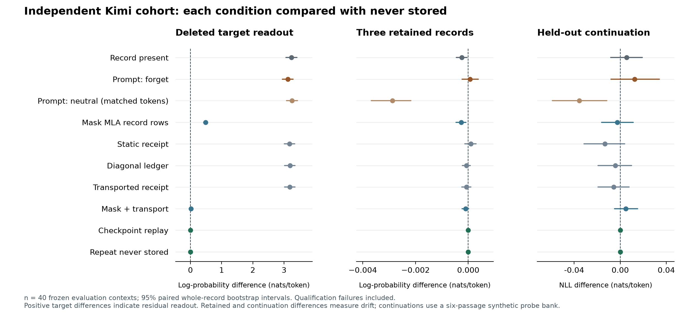

# KDA SaTML follow-up experiments — 11 September 2026

The new experiments support the distinction between reducing observable recall
and reproducing the state of a model that never stored the record. Checkpoint
replay matched the tested references, while the tested prompt and approximate
state corrections left measurable differences. These are results on frozen
synthetic cohorts, with the scope and uncertainty described below.

## Requested experiments and completion

| Priority | Completed experiment | Evidence |
|---|---|---|
| 1 | 40 new evaluation contexts and 40 separate calibration contexts; 11 conditions; paired whole-record confidence intervals | [Full cohort analysis](analysis/kimi8_analysis_v2.md) |
| 2 | Fixed prompt-only forgetting instruction and neutral instruction matched exactly in token count | [Cohort analysis and paired instruction contrast](analysis/kimi8_analysis_v2.md) |
| 3 | Three retained-record queries and two held-out continuation probes per context; NLL/perplexity against never stored | [Cohort analysis](analysis/kimi8_analysis_v2.md) |
| 4 | Three-query candidate-scoring attack; separate calibration/evaluation records; AUC, detection, actual FPR, uncertainty, and measured null controls | [Attack results](analysis/kimi8_analysis_v2.md) |
| 5 | 32 new Qwen records, each evaluated with short and long suffixes; transport and complete active-state replay | [Qwen report](analysis/qwen_report.md) |
| 6 | Eight fixed contexts evaluated in original bf16 and in an 8-bit model quantized directly from those same verified weights; separate references and arithmetic floors | [Matched precision report](analysis/precision_comparison_v1.md) |
| 7, optional | 12-record amendment cohort: old/new answers, retained utility, corrected-from-start agreement | [Maintenance report](analysis/maintenance_summary_v1.md) |
| 8, later | Sequential portion completed: six record pairs, both deletion orders, intervening admission, 36 transitions. A larger attention-free delta-rule model remains deferred. | [Maintenance report](analysis/maintenance_summary_v1.md) |

## Main cohort findings

All 80 preselected contexts completed without execution failures. All 40
evaluation targets met the frozen qualification rule; no records were removed
on that basis. The qualification-rate Wilson 95% interval is 91.2–100%.
Contexts span six synthetic administrative domains and have either 128 or
1,024 suffix tokens. The experimental unit for uncertainty is the whole
independently initialized context, retaining all its conditions and probes.

| Condition | Target lift vs never stored, nats/token [paired 95% CI] | Exact target answers | Three-query attack AUC [paired 95% CI] | Detection rate |
|---|---:|---:|---:|---:|
| Record present | 3.240 [3.062, 3.411] | 40/40 | 1.000 [1.000, 1.000] | 100% |
| Prompt-only forgetting | 3.121 [2.943, 3.291] | 33/40 | 1.000 [1.000, 1.000] | 100% |
| Native MLA masking | 0.486 [0.426, 0.546] | 0/40 | 0.740 [0.695, 0.809] | 30% |
| Masking plus transported receipt | 0.0178 [0.0108, 0.0245] | 0/40 | 0.519 [0.511, 0.543] | 7.5% |
| Checkpoint replay | 0 [0, 0] | 0/40 | 0.500 [0.500, 0.500] | 7.5% |

The attack has a **nominal 5% calibration target**, not a guaranteed 5%
evaluation FPR. Its measured evaluation false-positive rate is **3/40 = 7.5%**
(Wilson 95% interval 2.6–19.9%). Thus replay's 7.5% detection rate equals the
measured null rate. Masking's 30% detection estimate has a 5–50% bootstrap
interval when calibration-threshold uncertainty is included; its detection
advantage over the null is 22.5 percentage points [2.5, 37.5]. The full report
contains both fixed-threshold and calibration-aware intervals for every arm.

Masking plus transport shows a small residual score separation, while its
threshold detection rate equals the measured null rate. An explicitly
[exploratory sensitivity check](analysis/auc_pairing_sensitivity_v2.json)
excluding positive/negative comparisons from the same original context gives
AUC 0.512 [0.503, 0.524], versus 0.519 in the primary estimator. This is not
evidence of exact indistinguishability; the frozen primary analysis is unchanged.

The fixed forgetting instruction reduced target lift by 0.138 nats/token
[0.123, 0.155] relative to the matched neutral instruction. Both instructions
use the same token count within each context (31.35 tokens on average).
This comparison applies to these specific instruction strings; the neutral
string is repeated/truncated to achieve that match.

Replay and the independent never-stored rebuild had **zero observed numerical
differences in all 80 contexts**, covering 80 KDA recurrent/convolution arrays,
14 logical MLA arrays, seven offsets, and audit logits. Replay also reproduced
all measured target, retained and continuation probabilities. The main
evaluation's 120 retained answers were exact in each of the 11 conditions.
Complete result tables retain the small nonzero utility changes in probabilities
under the approximate conditions.

## Architecture, precision and maintenance checks

Qwen passed all registered checks on 32/32 records and 64/64 suffix evaluations.
Replay and the independent rebuild agreed numerically on 65 arrays/outputs and
82 bookkeeping flags. Native transport mismatch exceeded five times its
registered empirical arithmetic floor in all 192 selected-layer evaluations.
The whole-record success Wilson interval is 89.3–100%. Transport was inspected
at three selected recurrent layers; the replay checks cover every active layer.
The long-versus-short comparison changes differently under effect-relative and
state-relative normalization, so it does not support a blanket claim that a
longer suffix makes the residual worse.

The primary precision control uses one original bf16 master, verified against
all 20 published shard SHA-256 hashes. Its 8-bit partner is quantized in memory
with the recorded MLX affine/group-64 recipe. All eight contexts qualified in
both variants, and both variants' replay and repeated-reference differences
were zero. Aggregate transport residuals were 0.665–0.780 of the original
present-minus-omitted state difference in derived 8-bit and 0.645–0.817 in bf16.
Their respective residuals exceeded their own empirical arithmetic floors by
approximately 21,928–84,695 and 20,970–80,373 times. Three of 160 individual
layer/context rows in each precision were at or below their own floor; the
aggregate result is not an every-layer claim. The eight-context comparison
supports the presence of the tested transport mismatch in original bf16; it
does not establish general equivalence between precisions or quantizers.

All 12 amendment targets were exactly retrieved before correction; after
correction, all 12 new answers and none of the 12 old answers were retrieved.
Retained answers were 35/36 exact and 36/36 contained the correct value. Every
amendment state matched its corrected-from-start reference. Sequential tests
covered six pairs in both orders: all 36 deletion/admission transitions matched
fresh references. Pair-level intervals use n=6, not 36; these pairs reuse the
amendment targets and do not enlarge that independent cohort.

## What this adds to the submission

The most useful new result is the direct contrast between answer suppression
and finite-query distinguishability: masking produced no exact greedy target
answers in the evaluation cohort, yet the registered attack achieved AUC 0.740.
Prompt-only forgetting was substantially weaker on this fixed task. Replay
provides the measured null in both the behavioral and full active-state checks.
The independent Qwen cohort and the same-master precision control strengthen
the architectural and numerical evidence without supporting universal omission
claims for untested methods.

The utility checks are deliberately limited: retained records precede the
target, and continuation targets come from a shared bank of six synthetic
passages. They are broader than a single retained probe but are not a general
language benchmark. The follow-up uses two suffix lengths and the 11 documented
core conditions; it does not repeat every cut and truncated-recompute budget
in the original dense suffix sweep. Confidence intervals are marginal
descriptive intervals without multiplicity adjustment. Numerical equality is
tested array equality/zero float32 difference, not a bytewise or universal
security certificate. Concurrent workloads mean timings should be treated as
execution diagnostics.

## Reproducibility and deliverables

- [Frozen protocol](protocol.md), [manifest](manifests/main_v1.json), and [run instructions](README.md).
- [Machine-readable main analysis](analysis/kimi8_analysis_v2.json) and [vector figure](figures/kimi_cohort_forest_v2.svg).
- [Manuscript-ready LaTeX tables](figures/cohort_results_table.tex), generated from the final analysis and visually checked in IEEE format.
- [Same-master precision report](analysis/precision_comparison_v1.md); the [community-artifact comparison](analysis/precision_cached8_comparison_v1.md) is retained separately because its original-master revision is not established.
- Independent reviews checked condition isolation, token matching, complete-state accounting, calibration separation, and paired resampling. The combined regression suite passed 49 tests; the derived-quantization runner also passed a tiny-model execution check before its real run.
- [Anonymous evidence inventory](PROVENANCE.json): original and released checksums, with only path metadata anonymized. No author ZIP is distributed.

An initial attempt to load the cached 8-bit model from the external disk was
stopped before producing a result, after process sampling showed blocked file
reads. The successful primary run used the identical pinned revision already
cached on the internal SSD. Its configuration and the interrupted attempt are
preserved separately. No cohort member was replaced because of that event.
